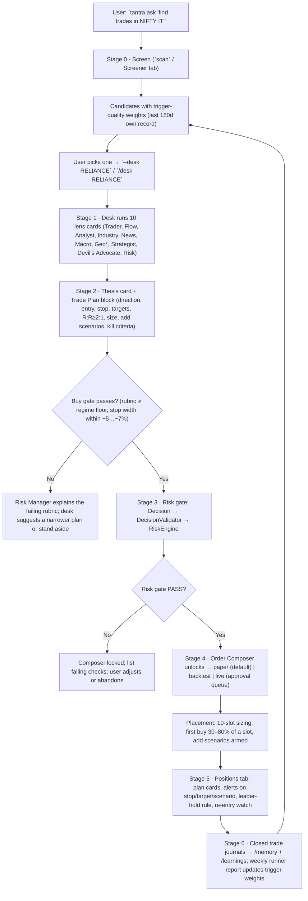

# Agent Desk UI Wiring & Winning-Trade Flow — Design

**Status**: Design reference for `tantra-ui/docs/plans/0007-*` (docs/design/plan only; no UI code).
Companions: `tantra-ui/docs/reference/cli-and-tui.md` (current surfaces) and
`tantra-agent/docs/design/agent-roster-culmination.md` (the 14-persona desk).

This document is the design source for two things:
1. **UI wiring** — how the 14-persona roster and its lenses surface across `tantra-cli`,
   `tantra-tui`, and the web AgentChat / Trade Lab.
2. **Winning-Trade Flow** — the guided user journey from candidate discovery to a risk-gated,
   placed, monitored, and journaled trade.

---

## 1. Surface Inventory (current → target)

| Surface | Current | Target (after plan 0007) |
|---------|---------|--------------------------|
| `tantra ask --persona <name>` | 9 personas | 14 personas + `--lens` + `--desk <symbol>` |
| `tantra chat --persona` | 9 personas | 14 personas + `--lens` |
| `tantra jobs add` | `--read-only` advisory | optional `--desk`/`--persona`/`--lens` goal decorators |
| `tantra trade` | — (new) | place a validated Trade Plan (paper/backtest/live) |
| TUI `/agent <name\|off\|default>` | 9 personas | 14 personas; `@lens` suffix; `/lens`; `/desk <symbol>`; `/trade` |
| TUI command palette | 40 commands | + `/lens`, `/desk`, `/trade` |
| Web AgentChat picker | 9 personas | 14 personas + lens dropdown + Desk mode |
| Web Trade Lab | — (new) | thesis card → Order Composer → risk strip → position plan cards |
| Result blocks (`tantra/result/v1`) | plan 0003 | lens cards collate into Desk Report artifact |

---

## 2. UI Wiring

### 2.1 Persona resolution & aliases

Persona names and folded-source aliases resolve in `tantra-agent-prompt::AgentPersona::from_name`.
The UI passes names through untouched, so wiring is purely additive:

- New names: `trading-flow-analyst`, `industry-analyst`, `information-analyst`,
  `investment-strategist`, `geopolitics-analyst` (and short forms: `flow`, `industry`, `news`,
  `strategist`, `geopolitics`/`geo`).
- Folded aliases: `technical-analyst → trader`, `financial-analyst → analyst`,
  `market-analyst → macro-strategist`, `portfolio-consultant → portfolio-manager`,
  `buy-specialist → trader`, `sell-specialist → trader`, `summary-optimizer → tantra-ai`,
  `quality-evaluator → tantra-ai`, `dialogue-manager → tantra-ai`.
- Alias resolution displays the resolved persona ("technical-analyst → Trader") so the user learns
  the mapping the first time they use it.

### 2.2 Lens flag contract

```
--lens <name>                 # CLI: applies a lens to the active persona
/agent macro-strategist@keynesian   # TUI: persona + lens in one argument
/lens <name>                  # TUI: switch lens of active persona
```

Lens namespaces (valid per host persona):

| Host persona | Lens namespace |
|--------------|----------------|
| macro-strategist | capitalist, keynesian, neoliberal, socialist, mixed, mercantilist |
| investment-strategist | buffett, graham, lynch, munger, klarman, marks, greenblatt, einhorn, miller, eveillard, whitman |
| geopolitics-analyst | region: russia, china, usa, europe, middle-east, africa, india-pakistan, japan-korea, latin-america, arctic · order: american-order, chinese-order, european-order, islamic-order, multipolar-order · board: eurasian-balkans, geopolitical-pivots, active-players, american-primacy, eurasian-heartland |

Invalid `persona×lens` combinations are rejected with a suggestion (e.g.
`--lens buffett` with `trader` → "lens `buffett` lives on `investment-strategist`").

### 2.3 Desk runner (`--desk <symbol>` / `/desk <symbol>`)

Ordered 10-stage pipeline with a fixed card order so multi-agent output is scannable:

```
[1 Trader]        [2 Trading Flow]      [3 Analyst]
[4 Industry]      [5 Information]       [6 Macro]
[7 Geopolitics*]  [8 Strategist thesis] [9 Devil's Advocate]
[10 Risk verdict] ──► "Proceed to trade plan?" (only if gates pass)
```
`*` Geopolitics runs when requested (`--lens`) or when the Macro card flags event risk.

Each card is a `tantra/result/v1` DisplayBlock (table / metric-grid / sparkline). The collated Desk
Report is saved to `/artifacts` with the as-of timestamp per card.

### 2.4 Order Composer (`/trade`, web "Place")

State machine for the composer:

```
┌────────────┐  ┌──────────────────┐  ┌──────────────────────┐  ┌───────────────┐
│ Trade Plan │→ │ Risk-gate check  │→ │ Review validated     │→ │ Placement     │
│ (from      │  │ Decision→        │  │ order + charges      │  │ paper|backtest│
│  strategist)│  │ Validator→Risk  │  │ (symbol, side, qty,  │  │ |live(approve)│
└────────────┘  └──────────────────┘  │ price, algo_id)      │  └───────────────┘
                                      └──────────────────────┘
```

- Composer fields are pre-filled and editable; the **Place** button stays disabled until the risk
  strip reads all-PASS.
- Risk strip reads `risk_inspect`/`/account`: SEBI algo-id & OTR state, price band, freeze limit,
  margin headroom, concentration.
- Statutory preview via `tantra_calculate`: STT, exchange turnover, SEBI fees, stamp duty, GST.

---

## 3. Winning-Trade Flow (end-to-end)

The flow is a re-implementation of Prism Insight's trading loop
(<https://github.com/dragon1086/prism-insight> — screen → AI analysis → buy rubric → small first
buy → scenario adds → leader hold → re-entry → weekly review) on Tantra's stack.

### Mermaid flow (TUI/web paths)



### Stage-by-stage contract

| Stage | Surface | Output | Gate |
|-------|---------|--------|------|
| 0 · Screen | `scan` / Screener tab | candidate list + trigger weight | none (read-only) |
| 1 · Desk | AgentChat / `--desk` | 10 lens cards (result blocks) | each card cites as-of figures |
| 2 · Thesis | Strategist card | thesis + Trade Plan block | conflict between lenses resolved & shown |
| 3 · Buy gate | Trader (buy mode) | rubric score 1–10 + regime floor | score ≥ floor; stop width ≤ regime limit |
| 4 · Risk gate | RiskEngine strip | pass/fail per SEBI check | **all PASS** to unlock placement |
| 5 · Place | Order Composer | validated order + charges | paper auto / live → approval queue |
| 6 · Manage | Positions / alerts | plan cards, add scenarios, leader hold, re-entry | alerts on levels; holds per rule |
| 7 · Review | `/memory` `/learnings` | per-trigger win-rate → trigger weights | weights feed Stage 0 |

### The "if any" honesty rule

The flow does not promise a winning trade. It promises the **highest-fidelity path to one**:
- If the desk gates fail (Stage 3/4), the system **stands aside** — "cash" is a valid, surfaced
  outcome (Klarman/Eveillard discipline), not a dead end.
- Every plan carries kill criteria and a falsifier, so a losing trade is cut small and the loss is
  journaled (Prism's own finding: the system's losses came from holding losers too long / selling
  leaders too early — the leader-hold and stop rules target exactly those).

---

## 4. State Models (web `tantra-ui-app`)

Read-only / additive to plan 0003 result blocks:

| Model | Kind | Fields (exact Decimal where money) |
|-------|------|-------------------------------------|
| `LensCard` | read | persona, lens, section title, DisplayBlocks, as_of |
| `DeskReport` | read | symbol, cards[], gates[], proceeded: bool, artifact ref |
| `TradePlan` | read | direction, entry, stop, target1, target2, rr, size, add_scenarios[], leader_hold, kill_criteria[] |
| `RiskStrip` | read | per-check pass/fail: algo_id_otr, price_band, freeze, margin, concentration |
| `OrderDraft` | rw | symbol, side, qty, price, algo_id, rationale, mode, approval |
| `PositionPlan` | read | position ref, add_scenario states, leader_hold status, stop, reentry_watch |

WASM constraints hold: no blocking I/O, no native threads, `wasm32-unknown-unknown`-clean, zero
floats.

---

## 5. Verification Plan (when implemented)

- Unit tests in `tests/` per crate (parallel test directory rule): lens-validation tables,
  desk-card ordering, risk-gate lock logic (composer disabled until all-PASS), alias resolution.
- TUI integration tests: `/desk` renders 10 cards; `/trade` locks/unlocks with risk strip.
- `cargo clippy --workspace --all-targets --profile prod -- -D warnings`;
  `cargo test --workspace --profile prod`; WASM build check.
- Golden JSON fixtures for a full paper trade: screen → desk → plan → risk-pass → placement →
  journal row, with `Decimal`-exact values.
